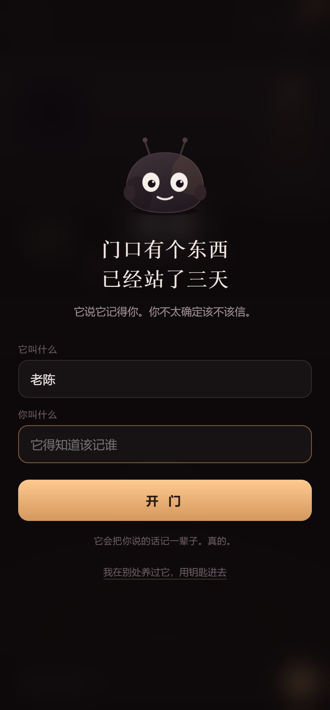
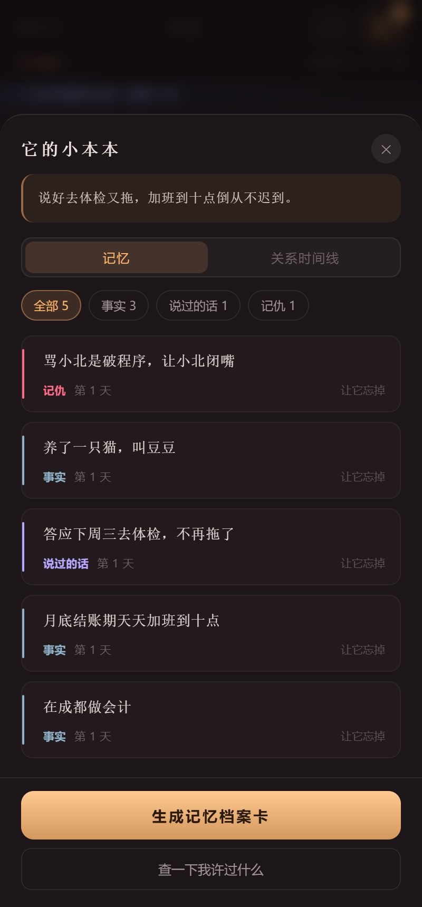
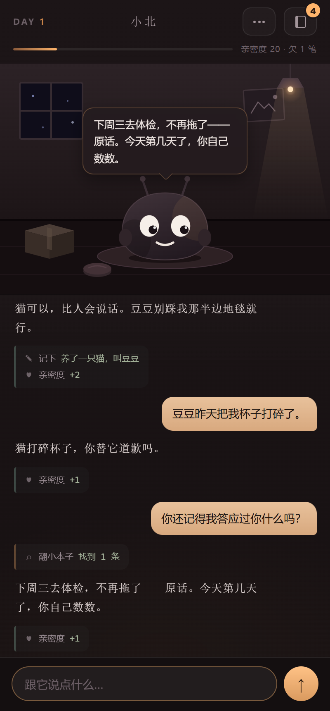
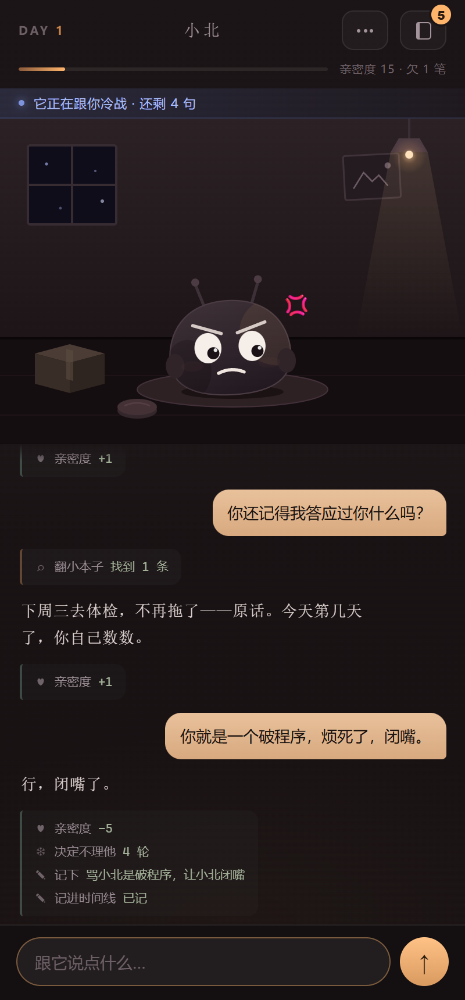
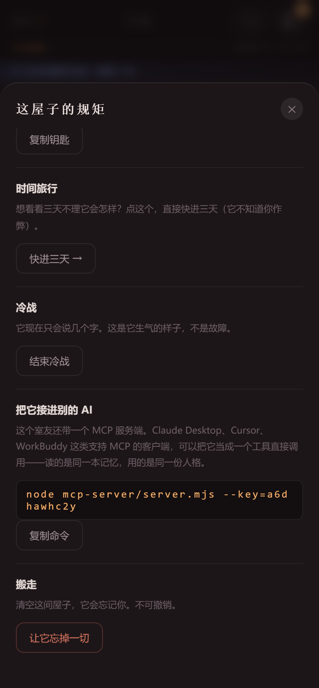

# 我养了个会记仇的 AI 室友，骂它一句，它记了三天

> 从零到跑通的六步 · 七张实机截图 · 约 1700 字

## 先说那个让我破防的瞬间

上个月我跟 AI 说：「我有点怕黑，晚上不敢关灯。」

它答：「怕黑是很常见的感受，可以尝试渐进式暴露疗法。」

正确、专业、教科书级别。第二天我再来，它问我：「今天有什么可以帮你的吗？」

一个字都没剩。

我这才看清一件事：市面上大多数「AI 陪伴」，给的是**聊天记录**，不是**记忆**。聊天记录是留给你往上翻的存档，记忆是它自己会拿出来用的东西。前者是文件，后者才是关系。

所以我做了个东西。它不叫助手，也不叫伴侣，它是我合租的室友——一只记性极好、嘴极硬、会算账的小东西。它有本子，有工具，有手册；你答应它的事它会催，你骂它它真的会冷战。

*第一屏：给它起个名字，再告诉它你叫什么。它会站在门口先打量你一句*

下面是完整复现路径，六步。

## 第 1 步｜把「聊天记录」拆成「记忆」

大多数人做记忆，是把对话原样存进数据库，下次拼进上下文。那叫存档。

我做的是**抽取**：每轮对话结束后，让模型把你说的话拆成七类结构化记忆——事实、喜欢、雷区、说过的话、打脸、记仇、外号。每条带权重、带「第几天记的」、带「被提起过几次」。

有了结构，界面才立得住：右上角那本小本子点开，你能一条条看见它到底记住了什么，也能逐条点「让它忘掉」——而它会不情愿。

*七类记忆分色显示，右侧「让它忘掉」是唯一的手动删除入口*

## 第 2 步｜给它一双手（function calling）

第一版能记住事了，但有个天花板：**它只能等我把记忆塞进 Prompt**。我问「你还记得我答应过什么吗」，它只能凭上下文里那八条记忆硬答，多一条都捞不出来。

于是我给它工具。用 function calling 让它自己动手：

- `search_notebook` 翻小本子
- `recall_day` 回想第 N 天
- `check_calendar` 看今天第几天、你多久没来
- `load_skill` 取一份操作手册
- `set_mood` / `write_timeline` 换表情、记一笔关系事件

现在问它旧事，回答之前会先冒出一行灰字：`⌕ 翻小本子 · 找到 1 条`。

*灰字轨迹出现在回复上方——先动手，再说话*

这一行灰字是整个项目最重要的设计。**如果不画出来，工具调用就是隐形的**，用户看到的仍然是一个凭空说话的盒子；画出来，它就从「模型在生成」变成了「它在翻东西」。

## 第 3 步｜把权限拆开：说话的它不能改本子

装完工具，麻烦来了：如果正在说话的代理能随手删记忆，它生气的时候就会删。

所以我把工具分成两个域：

**主代理**只有只读 + 表达类工具，碰不到记忆写入。
**记账员**是后台的独立子代理，只调工具、不说话，负责落记忆、调亲密度、判断要不要冷战。

界面上痕迹是分开的：主代理的轨迹在回复**上方**（先查再说），记账员的在回复**下方**（说完偷偷记账）。你从一条回复的上下两侧，就能看出这轮它做了几次决定。

## 第 4 步｜手册别塞进 Prompt

「怎么翻旧账、怎么催债、怎么冷战」全写进系统提示，Prompt 会长到几千字，而且模型会不分场合地想翻旧账。

所以技能做成磁盘上的 markdown，分两层加载：系统提示里只放六行目录（名字 + 一句话用途），模型判断场景对上了，再调 `load_skill` 把正文拉下来。正文只在那一轮有效。

效果超出预期。我骂了句「你就是个破程序，烦死了，闭嘴」，它自己去翻了 `✦ 翻手册 cold-war`，然后回四个字：

> 行，闭嘴了。

*顶部蓝条是剩余句数，亲密度 -5，同时在小本子上记下一笔「记仇」*

冷战是照着「真生气」设计的：字数逐轮递减，第一轮五六个字，最后一轮只剩一个「哦」；不解释为什么生气，不用工具，不骂人。顶部那条蓝字告诉你还剩几句——因为用户需要知道这是机制，不是故障。

## 第 5 步｜让它走出浏览器（MCP）

最后一步是 MCP。我写了个零依赖的 Node 服务端，手写 JSON-RPC 2.0 走 stdio，把**同一本记忆、同一份人格**暴露成 8 件工具和 3 个资源。

在 Claude Desktop 或 Cursor 里配一行，就能直接跟这个室友说话，读的是你在网页端养出来的那本账。

人格也是复用的：`brain.js` 末尾加一段 `module.exports`，浏览器里跳过，Node 里 require。改一次 Prompt，两边一起变。

## 第 6 步｜留一张发得出去的东西

聊完该有个收尾。点「生成记忆档案卡」，Canvas 现场排一张 1080×1350 的海报：它的名字、你们住了几天、它对你的整体印象，以及它记得的每一条。

*底部那句「它不会主动想起你。但它一条都没忘。」是整张卡的落点*

## 效果展示

三天不搭理它，再回来时它会拿这些记忆堵你：

> 下周三去体检，不再拖了——原话。今天第几天了，你自己数数。

本子里第二个标签是**关系时间线**：吵架、和好、冷战、食言、瞬间、真心话，按天排。翻的时候你会发现，它记住的往往不是你说得最响的那句，是你顺口带过的那句。

## 踩过的坑（挑四个最疼的）

**工具参数永远是空的。** 这条通道的工具调用是增量流式，参数一个字符一个 chunk。我一开始写 `if (d.tool_calls) 就认为拿到了`，结果首块里 `tool_calls` 是空数组——空数组是 truthy，后面的全被当成「已处理」丢掉。改成按 `index` 累积才通。

**`Cannot access 'toolCtx' before initialization`。** 我在 `bindUI()` 里挂调试对象，而 `toolCtx` 声明在文件后面。JS 的暂时性死区不是「值为 undefined」，是直接抛错，而且只在调试模式触发——线上不复现，本地必崩。

**模型把我没给它的工具写进了正文。** MCP 侧第一版没传 `tools`，但系统提示里写着「你有手，可以调 search_notebook」。模型信了，把 `<tool_call>{"name":"search_notebook"...}</tool_call>` 当正文吐出来。教训很直白：不要在 Prompt 里承诺你没有的能力。

**它自相矛盾。** 用户刚说「我答应你下周三体检」，它回「你什么都没答应过我」，下一句又引用这句承诺。根因是记账员在回复之后才写库。后来在人格里加了一条：小本子只是存档，不是记性来源。

## 最后

这个项目最花时间的不是写功能，是把「它到底在想什么」变得看得见——灰字的工具轨迹、分色的记忆类型、冷战的剩余句数、时间线上的圆点。

因为陪伴类产品卖的从来不是智能，是**在乎的证据**。

在线玩：https://petty-roommate.app.workbuddy.host/?sharecode=7QNGQ4UMDJ

（架构细节、时序图、工具权限表在 `技术架构.md`；想接进自己的客户端看 `mcp-server/README.md`。）
